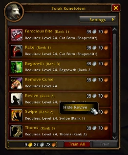
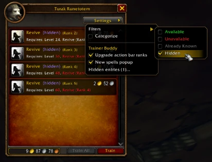
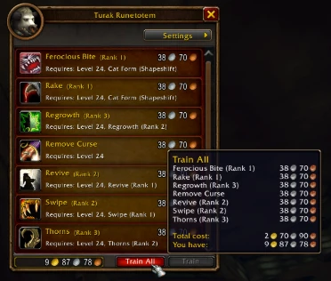
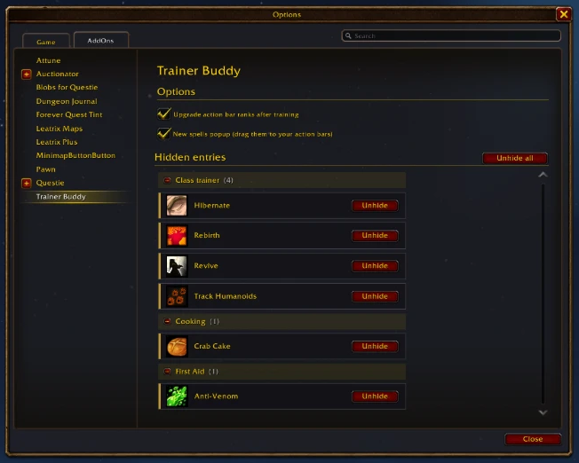
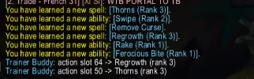
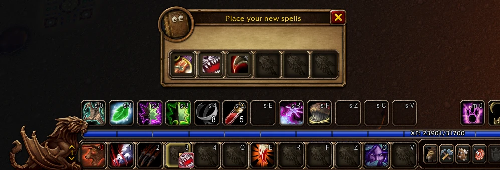

# Trainer Buddy

Trainer visits, minus the busywork. Hide the spells and recipes you never want, learn everything else with one click, and get your new spells onto your action bars without digging through the spellbook.

Made for **World of Warcraft: Forever**.

## Features

### Hide what you don't need

Right-click any entry in a class, pet or profession trainer window and choose **Hide**. It disappears from the list for good, and so do all the ranks you can still learn. Ranks you already know are left alone: hide Revive as a feral druid, keep rank 1, and never get offered rank 2.

Want to see hidden entries again? Tick **Hidden** under the trainer's *Settings > Filters*. Hidden entries always show up, marked, with **Show** in the right-click menu. Tick *Available* or *Unavailable* as well and you get those entries too; with only *Hidden* ticked you see just the entries you hid.

### Train All

A **Train All** button sits right next to *Train*. It buys every available, non-hidden entry you can afford, and skips what you hid. Hover it to see each entry with its price, the total cost, and how much you have.

Trainer Buddy remembers what each trainer you visit charges you (reputation discounts differ from town to town). If another trainer you visited before is cheaper for the same entries, the Train All tooltip adds a line like *Thunder Bluff cost: 1g 58s*, and the plain *Train* button's tooltip does the same for the selected entry. Visit a trainer once to teach it the prices.

### Hidden entries list

Everything you hid is listed under *Settings > AddOns > Trainer Buddy* (or `/trb`), grouped by class, pet and each profession, with collapsible groups. Every entry shows its icon and the spell tooltip, and has an **Unhide** button. You can also open the list from the trainer's Settings menu.

### Upgrade action bar ranks (optional)

After you learn a new rank, your previous highest rank is replaced on your action bars with the new one. Lower ranks you keep on purpose (downranking) stay where they are.

### New spells popup (optional)

Newly learned spells that are not on any action bar yet appear in a small window. Drag them onto your bars. It stays until you close it with the X, and it remembers its position. Talents show up there too.

Both optional features can be switched on and off in the trainer's Settings menu or in the addon's settings.

## Commands

| Command | Action |
| --- | --- |
| `/trb`, `/trainerbuddy` | open the settings and the hidden list |
| `/trb auto` | toggle action bar rank upgrades |
| `/trb popup` | toggle the new spells popup |
| `/trb test [count]` | preview the popup with `count` random spells from your action bars (no number: empty popup). Calling it again replaces the preview; close it with the X |
| `/trb help` | list all commands |

## Install

Copy this folder into `_forever_/Interface/AddOns/` and name it `TrainerBuddy`, so that `TrainerBuddy/TrainerBuddy.toc` exists. Then `/reload`. (Or install it with the CurseForge app.)

## Notes

- Made for WoW: Forever (retail-based, `## Interface: 16001`). If the game flags it as out of date, check your build with `/dump (select(4, GetBuildInfo()))` and adjust the TOC.
- Settings and the hidden list are saved per character.
- Druid form upgrades use Classic spell IDs (see `UPGRADES` in `TrainerBuddy.lua`); add pairs there if Forever differs.
- Feedback and bug reports are welcome in the comments on the CurseForge page.

## For developers

`./make-zip.sh` (macOS, Linux or Git Bash on Windows) builds `dist/TrainerBuddy-<version>.zip` with a single `TrainerBuddy/` folder holding only the game files, ready to upload to CurseForge. The version comes from the TOC. Add new textures or Lua files to `FILES` in the script; it stops with an error if the addon references a file that is not packaged. The `screenshots/` folder is only for this README and is not packaged.
